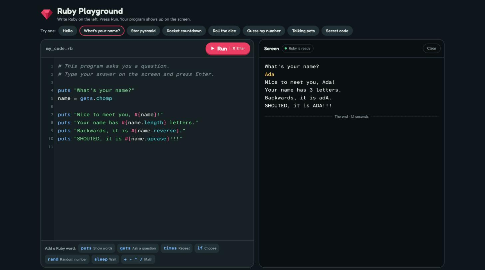
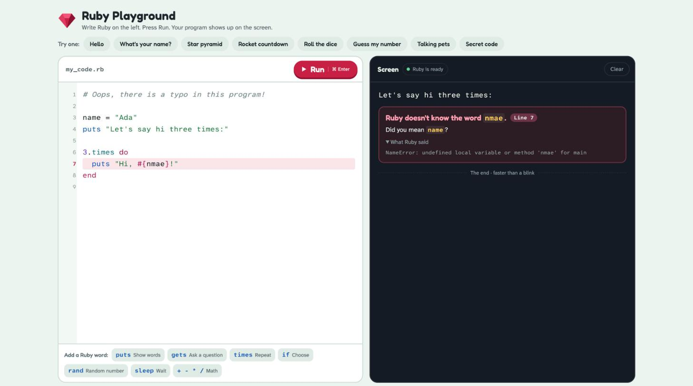
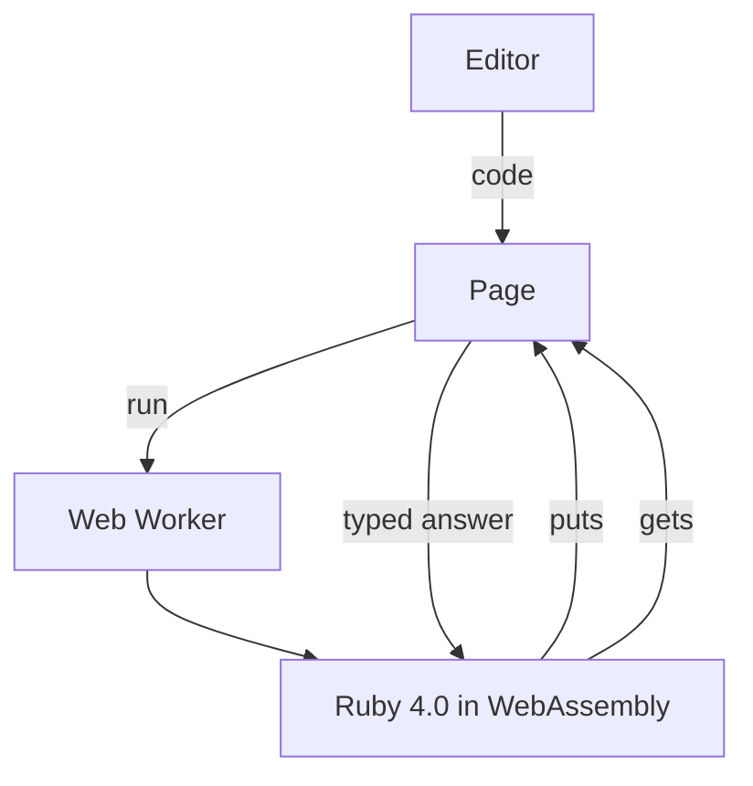

# Ruby Playground

A friendly place for kids to write real Ruby and watch it run, right in the browser.
Code goes on the left, and the result shows up on a little screen on the right. There's nothing to install.



It runs the real Ruby interpreter (Ruby 4.0.0, compiled to WebAssembly by the
[ruby.wasm](https://github.com/ruby/ruby.wasm) project), so what a kid learns here is the same Ruby they will
use later on a computer.

## What makes it kid-friendly

- **Big, readable code.** Large letters in Atkinson Hyperlegible, a typeface designed for easy reading, plus
  colored code, line numbers and automatic indenting after `do`, `if` and `def`.
- **Programs can ask questions.** When a program calls `gets`, a typing box appears right on the screen. Press
  Enter and the answer goes back to Ruby.
- **Countdowns work.** `sleep 1` really waits a second without freezing the page.
- **Errors explain themselves.** Ruby's error is turned into a hint, the line is highlighted, and the original
  message is one click away for the curious.
- **Eight starter programs**: Hello, What's your name?, Star pyramid, Rocket countdown, Roll the dice,
  Guess my number, Talking pets and Secret code.
- **Ruby word buttons** that insert `puts`, `gets`, `times`, `if`, `rand` and `sleep` with a small example.
- **Safety nets.** A Stop button, plus automatic stops for loops that print more than 2,000 lines or stay silent
  for 10 seconds.
- **Work is kept.** The code is saved in the browser, and opening an example offers "Bring back my code".
- **Light and dark themes**, following the computer's setting.

## Friendly errors



| When the code says | The playground says |
| --- | --- |
| `puts nmae` | Ruby doesn't know the word `nmae`. Did you mean `name`? |
| `put "hello"` | Ruby doesn't know how to `put`. Did you mean `puts`? |
| `puts "I am " + 9` | Ruby can't glue a number onto words with +. |
| `3.times do` with no `end` | Ruby reached the bottom, but something was still open. |
| `puts 10 / 0` | Nobody can divide by zero. Not even a computer! |

## Run it on your computer

The page loads Ruby with `fetch`, so it needs to be served over HTTP rather than opened as a file. Any static
web server works:

```sh
git clone https://github.com/sheetgenius/ruby-playground.git
cd ruby-playground
python3 -m http.server 8000
```

Then open <http://localhost:8000>. It has been tested in desktop Chrome. It needs a browser with WebAssembly and
`DecompressionStream`, which current Chrome, Edge, Firefox and Safari have.

To put it on the web, upload `index.html` and the `engine/` folder to any static host, such as GitHub Pages.
The browser keeps the engine after the first visit, so later visits start almost instantly.

## How it works



- **Loading.** The engine is about 5 MB compressed, split into 20 pieces that download side by side. The page
  joins them, unzips them with `DecompressionStream` and compiles the WebAssembly once.
- **Running.** Every Run gets a fresh Ruby in a Web Worker, so a program never sees leftovers from the last one,
  and Stop can end even an endless loop. A spare Ruby is warmed up in advance and starts in about 50 ms.
- **Talking to the page.** A small Ruby prelude (`src/prelude.rb`) replaces `$stdout` and `$stderr` so output
  streams to the screen as it happens. It makes `gets` and `sleep` wait on JavaScript promises, and it reports
  errors with the details the page needs for its hints.
- **"Did you mean".** The engine is the ruby.wasm build without the extra standard library, which leaves out
  the `did_you_mean` gem. The prelude has a small edit-distance suggester instead, which prefers the words a
  beginner is likely reaching for.

## Differences from Ruby on a computer

- Core Ruby is all there: strings, numbers, arrays, hashes, ranges, classes, `Set`, `Struct`, `rand` and
  `Time`. Libraries you `require`, such as `json` or `date`, are not included.
- There are no files, network access or threads.
- `gets` always reads from the typing box on the screen.
- `pp` prints the same way as `p`.

## Project layout

| Path | What it is |
| --- | --- |
| `src/page.html` | The page: layout, styles, editor, examples and error hints |
| `src/prelude.rb` | Ruby loaded into each fresh interpreter before the program runs |
| `build.py` | Builds `index.html` and `engine/` from `src/` |
| `index.html`, `engine/` | Built output, committed so a fresh clone runs as-is |
| `examples/hello.rb` | A first program to run with Ruby on a computer |
| `third_party/` | Licences and notices for the bundled Ruby engine |

## Changing it

Edit the files in `src/`, then rebuild:

```sh
python3 build.py
```

The first build downloads two pinned files from npm, the `@ruby/4.0-wasm-wasi` and `@ruby/wasm-wasi` 2.10.1
packages via jsDelivr, into `vendor/`. It checks their SHA-256 before using them.

To add a starter program, add a block like this to `src/page.html` next to the others, then rebuild:

```html
<script type="text/x-ruby" class="ruby-example" data-id="robot" data-name="Robot dance">
puts "beep boop"
</script>
```

## Licence and credits

Ruby Playground is released under the [MIT License](LICENSE).

It bundles a WebAssembly build of Ruby:

- **Ruby** is copyright Yukihiro Matsumoto and contributors, and is available under the Ruby License or the
  2-clause BSD License. Ruby's source code is at <https://www.ruby-lang.org/en/downloads/>.
- **ruby.wasm**, which builds Ruby for WebAssembly and provides the JavaScript runtime, is copyright Yuta Saito
  and released under the MIT License. Its source is at <https://github.com/ruby/ruby.wasm>.

Their licences and the third-party notices for the engine are in [`third_party/`](third_party/).

The page loads its typefaces (Fredoka, Atkinson Hyperlegible Next and Atkinson Hyperlegible Mono) from Google
Fonts. It loads the ruby.wasm JavaScript runtime from jsDelivr, falling back to the copy in `engine/`.
